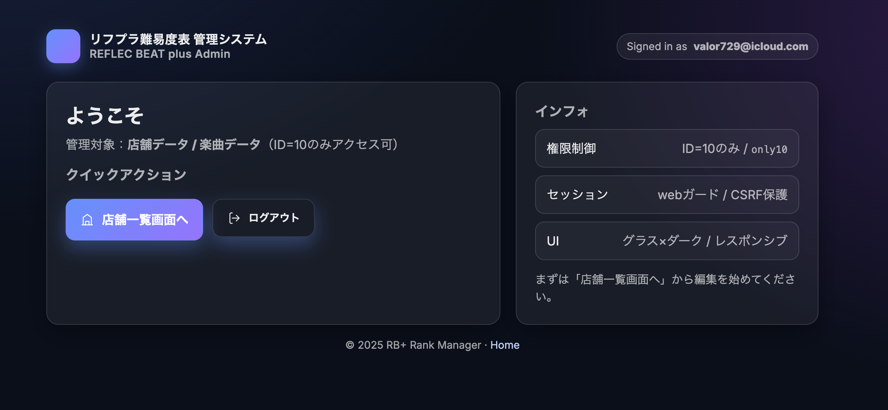

# 概要

本プロジェクトは、[REFLEC BEAT plus レベル11 難易度表＆クリアランク管理サイト](https://rbplus-rank-manager.site/)のバックエンドリポジトリである。

　※フロントエンドのリポジトリは[こちら](https://github.com/misato729/score-manager-frontend)

用途は以下の2つである。

① フロントのAPIリクエスト（スコアの取得・更新、設置店舗の取得など）に返答する。

② Laravel Bladeで開発したバックエンド直結の管理システムで設置店舗・楽曲情報の管理とユーザー一覧の確認を行う。

当初は①のみでリリースしていたが、管理システムでデータを管理できた方がサービス運用が楽になると思い、②の開発にも至った。

# 機能一覧
## APIレスポンス
本APIは、フロントエンドとのデータ送受信に利用する。
全エンドポイントは JSON 形式でレスポンスを返す。
認証が必要なエンドポイントは Laravel Sanctum によるトークン認証を使用。

### ユーザー関連
| メソッド   | エンドポイント          | 認証 | 概要                    |
| ------ | ---------------- | -- | --------------------- |
| POST   | `/login`         | 不要 | メールアドレス・パスワードでログイン    |
| POST   | `/register-user` | 不要 | 新規ユーザー登録（スコア初期化含む）    |
| GET    | `/user`          | 必要 | ログイン中ユーザーの情報を取得       |
| POST   | `/logout`        | 必要 | ログアウト（Sanctumトークン無効化） |
| DELETE | `/users/{id}`    | 必要 | ユーザーアカウント削除           |
| PUT    | `/users/target`  | 必要 | ユーザーのターゲットスコア設定を更新    |

### スコア関連
| メソッド | エンドポイント           | 認証 | 概要               |
| ---- | ----------------- | -- | ---------------- |
| GET  | `/users/{userId}/scores` | 不要 | 指定ユーザーの保存済みスコア一覧を取得 |
| GET  | `/users/{userId}/song-scores` | 不要 | 指定ユーザーの全楽曲とスコアを取得 |
| POST | `/scores`         | 必要 | 新しいスコアを登録        |
| PUT  | `/scores/{score}` | 必要 | 既存スコアを更新         |

### 店舗関連
| メソッド | エンドポイント          | 認証 | 概要             |
| ---- | ---------------- | -- | -------------- |
| GET  | `/shops`         | 不要 | 店舗一覧を取得        |
| POST | `/visit`         | 必要 | 行脚店舗を登録        |
| GET  | `/visited`       | 必要 | 自分の行脚店舗履歴を取得   |
| GET  | `/users/{userId}/visited-shops` | 不要 | 指定ユーザーの行脚履歴を取得 |

## 管理システム
本管理システムは **Laravel Blade（SSR）** を用いて実装したバックエンド直結の管理画面であり、 API経由ではなく直接データベースにアクセスして管理を行う。

### 機能概要
- **店舗一覧表示**  
  - すべての店舗情報をID順で表示  
  - 店舗名や住所の部分一致検索機能  
  - 公開中／削除済みの状態表示

- **店舗編集**  
  - 店舗名、住所、緯度経度、価格、台数、説明文、論理削除フラグを更新可能  
  - バリデーションチェック付き（必須項目・文字数・数値型）

- **論理削除**  
  - `is_deleted` フラグをON/OFFすることで、実データを残したまま表示制御
- **ユーザー一覧**（`/admin/users`）
  - 管理者専用で、ID・ユーザー名・メールアドレス・登録日時（日本時間）を表示
  - ユーザー名・メールアドレスの部分一致検索（英字の大文字・小文字を区別しない）
  - ID順に50件ずつ表示し、検索条件を保ってページを切り替え可能
  - 一覧の確認のみで、ユーザー情報の編集・削除は行わない
- **UIデザイン**  
  - CSSとシンプルなBlade構文によるレスポンシブ対応デザイン 
  - 成功／エラー時のトースト通知表示

### アクセス制御
- Laravel Sanctumによる認証
- ミドルウェアによって、環境変数 `ALLOWED_USER_ID` に設定されたユーザーID（自分）のみアクセス可能
- 未認証時はログイン画面へリダイレクト
- 認証済みでも許可されたID以外はHTTP 403を返却


### 技術ポイント
- Bladeディレクティブ（`@if`, `@foreach`, `@csrf`, `@method` など）を活用
- ルーティングは `routes/web.php` に定義し、`AdminShopController`・`AdminSongController`・`AdminUserController` で処理
- 管理画面とAPIのルーティングを分離（`web.php` と `api.php`）
- HTTPS強制設定（`AppServiceProvider` + RenderのForce HTTPS）

### 関連記事
- [Laravel Bladeで管理画面を作ってみた【MVC】](https://qiita.com/misato729/items/138a89c3ad8b3e2f0716)  
  → 管理画面（店舗CRUD）を作る過程を整理した学習アウトプット記事です。

## 設置店舗の自動非公開化・再公開

[KONAMI公式の設置店舗検索](https://p.eagate.573.jp/game/facility/search/p/index.html?gkey=REFLECC)を取得し、公開中の店舗が検索結果から5日連続で消えていた場合に `is_deleted` を `true` にする。自動非公開化した店舗が公式検索に復帰した場合は、自動で再公開する。
都道府県と店舗名で照合し、店舗名の全角英数字・空白の表記差を吸収する。

- 全47都道府県の検索結果を正常に取得できてから更新する。設置店舗が0件の県も正常な結果として扱う。
- 不在日数は日本時間の暦日ごとに記録する。同日の再実行で日数を増やさず、公式検索への復帰でリセットする。5日目の正常な確認で非公開化する。
- 取得失敗や実行されなかった日を挟む場合は、5日連続の不在を確認できないため、次に正常取得できた不在日を1日目として数え直す。
- 通信失敗や取得形式の変化を検出した場合は更新せず、エラー終了する。
- 再公開するのは、同期処理が自動非公開にした記録（`shop_sync_states.hidden_at`）がある既存店舗だけとする。手動で非公開にした店舗や削除済み（`deleted_at` が設定された）店舗は再公開しない。
- 管理画面で非公開の状態を保存した場合、公開状態を変更した場合、または店舗名・都道府県・住所を変更した場合は、不在日数と自動非公開の追跡をリセットする。公開中の店舗の価格・台数などだけを編集した場合は追跡を継続する。
- 新規登録や住所・価格・台数の更新は行わない。
- 店舗データや行脚履歴は削除しない。
- この仕様の導入前の不在日数は推測せず、導入後の正常な確認日から数える。

実行環境のデータベース設定を使い、次のコマンドで確認・更新できる。

```bash
# 変更候補の確認のみ（DB更新なし）
php artisan shops:sync-konami --dry-run

# 不在日数の記録・非公開化・再公開を実行
php artisan shops:sync-konami
```

### 毎日の自動実行

GitHub Actionsの `Sync KONAMI shops` が毎日07:30（日本時間、実行開始が遅れる場合あり）に店舗の掲載状況を確認し、不在日数の記録・非公開化・再公開を実行する。
RenderのWebサービスの起動状態に依存せず、GitHub Actionsから直接DBへ接続する。

1. コードとワークフローをデフォルトブランチ（`main`）へ反映する。定期実行はデフォルトブランチでのみ有効となる。
2. Renderのデプロイ完了とマイグレーション適用を確認し、通知保存用の `shop_sync_notifications` テーブルと掲載状況の追跡用の `shop_sync_states` テーブルを作成する。別の方法で配置する場合は、対象環境で `php artisan migrate --force` を実行する。通常の同期を実行する前に両テーブルの存在を確認する。
3. リポジトリの **Settings → Secrets and variables → Actions** に `SHOP_SYNC_DATABASE_URL` を登録する。値にはGitHub Actionsから接続可能なPostgreSQLの外部接続URLを使用する。Render内部向けURLは使用できない。店舗情報・掲載状況・通知記録の読み取り・更新に必要な権限を持つDBアカウントを使用する。
4. **Actions → Sync KONAMI shops → Run workflow** で `main` を選び、まず `dry_run` をオンにして変更候補を確認する。オフにすると更新する。定期実行時は更新する。

接続URLはGitHub Secretsで管理し、ログに出力しない。このワークフローはマイグレーションやシードを実行しない。

#### GASからの起動への切り替え

GitHub Actionsの予約イベントが遅延・欠落する場合に備え、追加費用なしでGoogle Apps Script（GAS）から毎朝07:30 JSTに既存のワークフローを起動できる。[設定手順とコード](automation/shop-sync/README.md)を参照する。GAS側で現在時刻を1分ごとに確認し、07:30以降にその日1回だけGitHubへ実行を依頼する。DB接続情報とSentry DSNは引き続きGitHub Secretsに保持する。

GASの動作確認が終わるまでは既存のGitHub予約を継続し、切り替え時にこのワークフローの `schedule` だけを削除する。`workflow_dispatch` はGASと手動確認の両方で使用する。GAS経由の実行には実行名に予定日と `GAS` が表示される。

Neonのpooler接続をPHP 8.3で使用するため、PostgreSQL接続に `PDO::PGSQL_ATTR_DISABLE_PREPARES => true` を設定している。RenderとGitHub Actionsの両方に適用し、[PHPのPostgreSQLドライバー](https://www.php.net/manual/en/class.pdo-pgsql.php#pdo-pgsql.constants.attr-disable-prepares)からクエリと値を分けて送ることで、booleanを含む型推論を維持しながらPgBouncerと非互換の名前付きprepared statementを避ける。

### 非公開化時のメール通知（Sentry）

公式検索で5日連続の未掲載を確認し、新たに非公開化した店舗がある場合、店舗名・都道府県・住所・管理画面の編集リンクと実行元をSentryへ通知し、SentryのIssue Alertからメールを送る。不在の1〜4日目や、掲載復帰による自動再公開時は新しい通知を作成しない。
公式検索から消えた理由は撤去だけでなく一時的な未掲載や店舗名の変更の場合もあるため、通知内容を確認する。自動非公開化した店舗が同じ都道府県・店舗名で公式検索に復帰すれば自動で再公開する。店名変更なら管理画面で公式検索と一致する店舗名へ修正し、非公開チェックを外して再公開する。

1. Sentryの対象プロジェクトのDSNを、GitHub ActionsのSecret `SHOP_SYNC_SENTRY_DSN` に登録する。ローカルなどから実行する場合は同名の環境変数に設定する。
2. Sentryで[Issue Alert](https://docs.sentry.io/product/alerts/create-alerts/issue-alert-config/)を作成する。環境を `production`、イベントのタグ条件を `event_type` が `shops_hidden`、発火条件を新規Issueの発生に設定する。非公開化の通知単位ごとにUUIDを含む[fingerprint](https://docs.sentry.io/platforms/php/usage/sdk-fingerprinting/)を使い、別の通知を新規Issueとして扱う。
3. 通知先には希望するメールアドレスを認証済みのプライマリメールにしているSentryメンバーを選ぶ。対象プロジェクト・チームへの参加と、本人のメール通知設定を確認する。アプリ側のSMTP設定や送信元メールアドレスの設定は不要。
4. 管理画面のURLを変更する場合は、GitHub ActionsのVariable `SHOP_SYNC_ADMIN_URL` を設定する。未設定時は `https://score-manager-backend.onrender.com` を使う。GitHub Actions外では同名環境変数を使い、省略時は `APP_URL` を使う。
5. **Actions → Sync KONAMI shops → Run workflow** で `test_notification` をオンにして実行する。明確なテスト表示のイベントだけを送信し、店舗の状態や通知履歴は変更しない。Sentryのイベントと受信メールを確認する。通常実行時はオフに戻す。環境変数を設定した環境では `php artisan shops:test-sync-notification` でも確認できる。

`--dry-run` では通知しない。新たな非公開化がなければ新しい通知は作成しないが、未送信の通知が残っていれば再送を試みる。
DSN未設定や送信失敗の場合も店舗の非公開化は継続し、通知内容をDBに保存する。設定・通信が回復した後の通常実行で未送信分を再送する。
導入前の未送信通知に5日連続の確認記録がない場合は、従来どおりの非公開化通知として送り、不在日数や自動再公開を推測して案内しない。
Sentryへの送信成功とメールの到着は別の確認となるため、運用開始時にはSentry上のイベント、Alert設定、受信メールまで確認する。

# CI/CD
本プロジェクトでは **GitHub Actions + Render** を用いた CI/CD を構築している。  
プルリクエストから本番デプロイまで自動化されており、安全かつ効率的な開発フローを実現している。

- PHPUnitによるFeatureテストを自動実行
- Laravel Factory を活用し、再現性のあるテストデータを生成
- テストが失敗するとマージ不可 (レビュー時に検知)
- `main`ブランチにマージされると Render へ自動デプロイ

# 反省点
- REST APIの設計思想上、ユーザーIDはクエリパラメータではなくパスパラメータにすべきであった。

# 今後の展望
ユーザー一覧の確認に加え、運用上必要なユーザー管理機能を検討していきたい。
